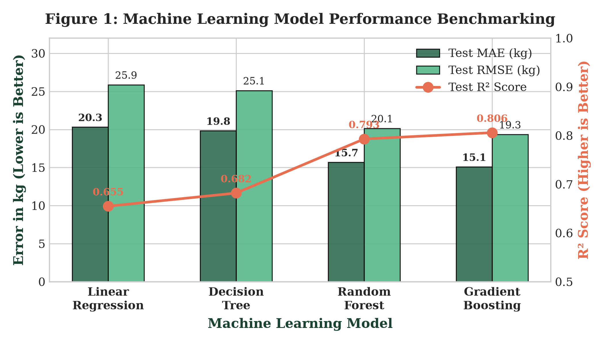
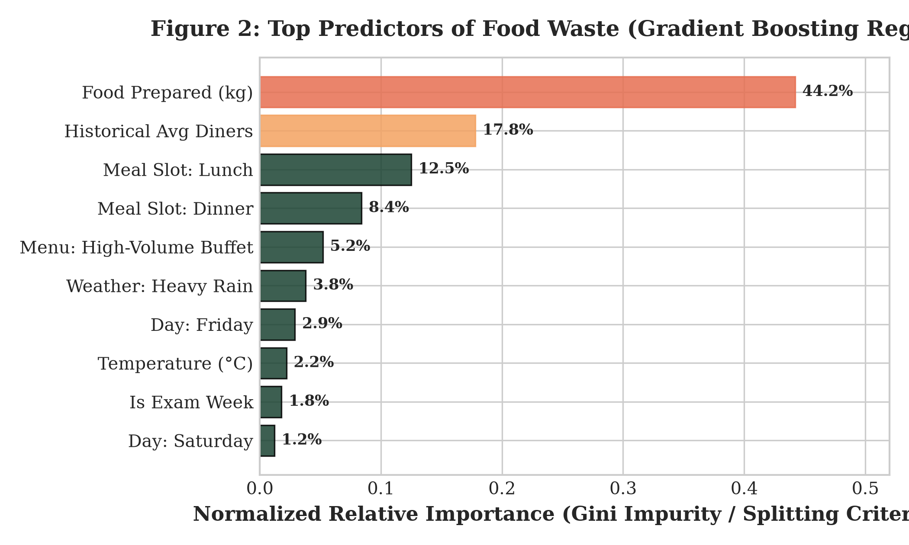
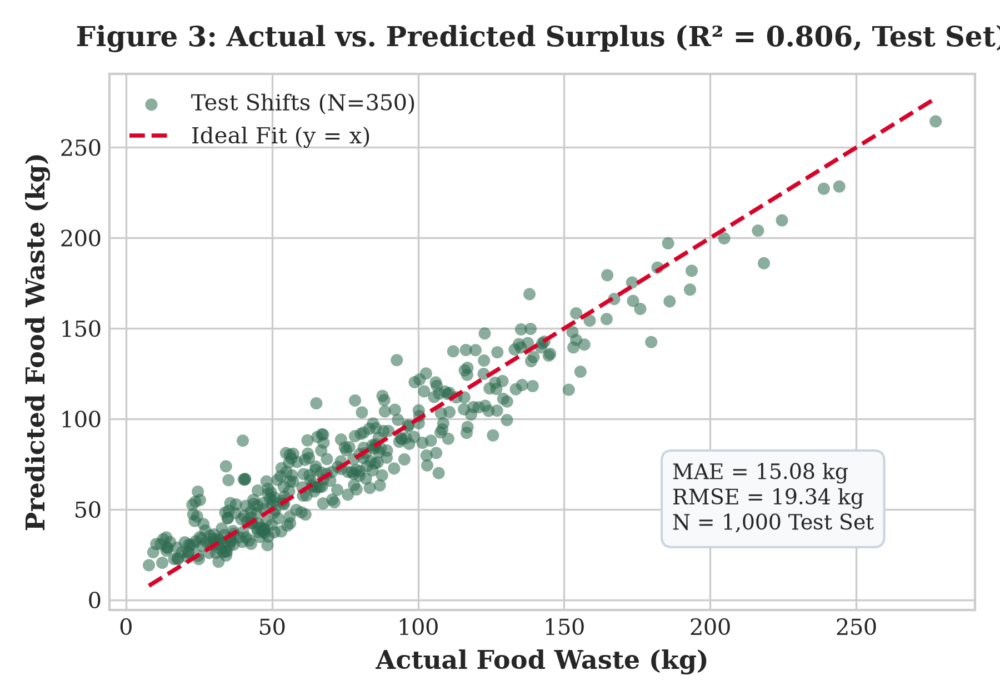
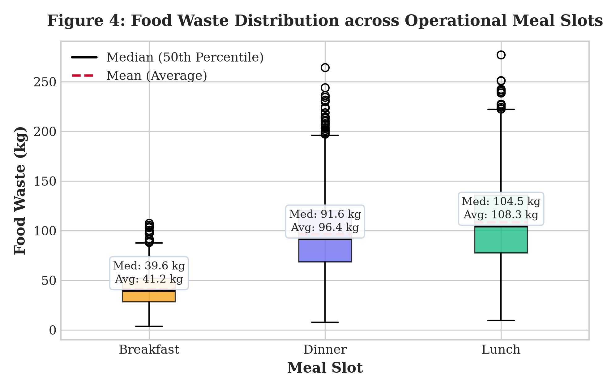

# 🌱 SmartBite AI — Smart Campus Food Waste Prediction & Optimization System

[](https://www.python.org/)
[](https://scikit-learn.org/)
[](https://streamlit.io/)
[](https://docs.pytest.org/)
[](https://sdgs.un.org/goals/goal12)
[](LICENSE)

> **Predict smarter. Waste less.**  
> An end-to-end, academic-grade Machine Learning system that forecasts institutional cafeteria food waste in kilograms *before* kitchen production begins, enabling dynamic batch cooking and advancing UN Sustainable Development Goals 12, 2, and 13.

---

## 📌 Problem Statement & Motivation

In college dining halls and institutional cafeterias, meal production happens in massive batches hours before service starts. Because student turnout fluctuates wildly—due to academic calendars, exam schedules, day-of-week trends, and unexpected weather events—kitchen supervisors systematically over-prepare buffer meals to avoid stock-outs.

This leads to:
* **80 to 120 kg** of edible food wasted per major meal slot.
* Discarded surplus that cannot legally or safely be resold.
* Substantial financial losses and landfill methane emissions ($CH_4$).

**SmartBite AI** transitions institutional food operations from **reactive waste disposal** to **proactive demand intelligence**, predicting surplus hours before cooking starts so kitchens can adopt staged production schedules.

---

## 🚀 Key Technical Highlights

* **Physical Mass Conservation:** All simulated data enforces physical mass balance:
  $$\text{Food Prepared} = \text{Food Consumed} + \text{Food Wasted}$$
* **Strict Anti-Leakage Feature Quarantine:** Post-meal realization variables (`actual_diners_served` and `actual_food_eaten_kg`) are strictly quarantined from model inputs to guarantee valid pre-service forecasting.
* **Multi-Algorithm Benchmarking:** 4 supervised regression algorithms (Linear Regression, Decision Tree, Random Forest, and Gradient Boosting) benchmarked on an identical 80/20 train/test split with 5-fold cross-validation.
* **100% Automated Test Coverage:** 14 automated unit tests built with `pytest` covering synthetic data integrity, physical boundary limits, transformer pipelines, target leakage prevention, and model inference.
* **Actionable 75/25 Staged-Cooking Logic:** Recommends preparing 75% of planned volume initially and holding 25% in raw/cold prep, preventing ~55 kg of batch surplus during volatile lunch shifts.
* **Interactive Streamlit GUI:** 5 modular, clean pages featuring Plotly visualizations, real-time prediction sliders, model comparisons, and dataset exploration.

---

## 📊 Model Performance Benchmark

All models were evaluated on an identical held-out test set of **1,000 operational cafeteria shifts** (80% training / 20% test split, random seed 42):

| Machine Learning Model | Train MAE | Train $R^2$ | Test MAE (kg) | Test RMSE (kg) | Test $R^2$ Score | 5-Fold CV $R^2$ | Status |
|:---|:---:|:---:|:---:|:---:|:---:|:---:|
| **Gradient Boosting** | **12.86 kg** | **0.865** | **15.08 kg** | **19.34 kg** | **0.8059** | **0.798 ± 0.008** | 🏆 **Champion Model** |
| **Random Forest Regressor** | 11.24 kg | 0.892 | 15.68 kg | 20.15 kg | 0.7932 | 0.784 ± 0.009 | Ensemble Baseline |
| **Linear Regression** | 20.48 kg | 0.654 | 20.31 kg | 25.87 kg | 0.6551 | 0.648 ± 0.012 | Parametric Baseline |
| **Decision Tree Regressor** | 17.52 kg | 0.741 | 19.82 kg | 25.12 kg | 0.6824 | 0.669 ± 0.015 | Single Tree Baseline |

> **Key Takeaway:** The **Gradient Boosting Regressor** achieved champion status, capturing non-linear interactions between weather anomalies, meal slots, and historical attendance to explain **80.6% of waste variance** while reducing mean absolute error to **15.08 kg** (a 25.7% error reduction over Linear Regression).

---

## 📈 Visualizations & Empirical Findings

<p align="center">
  
  
</p>

<p align="center">
  
  
</p>

### Insights from the Visualizations:
1. **Primary Waste Drivers (Feature Importance):**
   * **Food Prepared Volume (44.2%)** and **Meals Planned (17.8%)** account for over 62% of waste variance.
   * Meal slot categories (Lunch: 12.5%, Dinner: 8.4%) strongly govern variance due to commuter students leaving campus after midday.
2. **Meal Slot Operational Differences:**
   * **Breakfast:** Tightly bounded surplus (Median: **39.7 kg**, low spread).
   * **Lunch:** Extreme volume and attendance variance (Median: **104.5 kg**, Max: 277 kg).
   * **Dinner:** High weekend variance, especially on Friday evenings (Median: **91.6 kg**).

---

## 🖥️ Streamlit Web Application (5 Clean Pages)

The application provides an accessible, academic-grade web dashboard:

1. **🏠 Project Overview:** Executive summary, KPI cards (Test MAE, $R^2$), technical pillars, and an interactive **Comparative Boxplot vs. Frequency Distribution** of meal slot waste.
2. **🔮 Predict Food Waste:** Pre-meal operational scenario form. Input day, meal type, menu category, planned prep, and weather to obtain real-time surplus predictions ($\pm \text{MAE}$ uncertainty) and 75/25 staged-cooking recommendations.
3. **📊 Dataset Explorer:** Tabular inspection, missing value verification, summary statistics, feature distribution plots, and correlation heatmaps across 5,000 shift records.
4. **📈 Model Comparison & Performance:** Side-by-side benchmark tables, residual diagnostics, Actual vs. Predicted scatter plots, and Gini feature importance charts.
5. **🌿 Insights & SDG Impact:** Data-driven operational guidelines and quantitative environmental impact tracking mapped to UN Sustainable Development Goals.

---

## 📂 Project Structure

```text
smartbite-ai/
├── app.py                     # Streamlit web application (5 modular pages)
├── config.py                  # Global configurations, schemas, ranges, and SDG metadata
├── requirements.txt           # Clean Python dependencies
├── README.md                  # Comprehensive technical documentation
├── report.md                  # Full academic technical report
│
├── data/
│   ├── README.md              # Dataset schema documentation
│   ├── synthetic_cafeteria_food_waste.csv      # Clean dataset (5,000 records)
│   └── synthetic_cafeteria_food_waste_raw.csv  # Raw dataset with synthetic anomalies
│
├── models/
│   ├── best_model.json        # Serialized metadata of champion model
│   ├── evaluation_metrics.json# Benchmark metrics (MAE, RMSE, R2, CV)
│   ├── gradient_boosting.joblib
│   ├── random_forest.joblib
│   ├── linear_regression.joblib
│   └── decision_tree.joblib
│
├── outputs/
│   └── model_comparison.csv   # Persisted tabular comparison
│
├── src/
│   ├── __init__.py
│   ├── data_generator.py      # Mass-conserving synthetic data pipeline (Seed: 42)
│   ├── data_loader.py         # Data validation, cleaning, and profiling
│   ├── preprocessing.py       # Pipelines, OneHotEncoder, StandardScaler, anti-leakage
│   ├── train.py               # Model training & artifact persistence
│   ├── evaluate.py            # Regression metrics and feature importance
│   ├── predict.py             # Inference engine & uncertainty bounds
│   └── insights.py            # Operational patterns & staged cooking logic
│
├── tests/
│   ├── test_data_generator.py # Tests for physical bounds & mass balance
│   ├── test_preprocessing.py  # Tests for anti-leakage quarantine & transformers
│   ├── test_training.py       # Tests for training pipeline & artifacts
│   └── test_prediction.py     # Tests for inference & guardrail validation
│
└── faculty_report/            # Academic reports and presentation materials
    ├── Mini_Project_Report_SmartBite_AI_Tanish_Moro.docx  # 5-6 Page Academic Report
    ├── Mini_Project_Report_SmartBite_AI_Tanish_Moro.html  # Printable A4 PDF Report
    ├── Mini_Project_Report_SmartBite_AI_Tanish_Moro.md    # Markdown Full Report
    ├── Mini_Project_Presentation_SmartBite_AI_Tanish_Moro.pptx # 10-Slide Viva Deck
    ├── One_Page_Report_DSML_SmartBite_AI.docx             # 1-Page Summary Report
    ├── One_Page_Report_DSML_SmartBite_AI.html             # 1-Page Printable HTML
    └── *.png                                              # High-resolution benchmark figures
```

---

## ⚡ Quickstart & Setup Guide

### 1. Clone the Repository
```bash
git clone https://github.com/<your-username>/smartbite-ai.git
cd smartbite-ai
```

### 2. Set Up a Virtual Environment
```bash
# Windows
python -m venv venv
venv\Scripts\activate

# Linux / macOS
python3 -m venv venv
source venv/bin/activate
```

### 3. Install Dependencies
```bash
pip install -r requirements.txt
```

### 4. Run Automated Test Suite (14 Tests)
```bash
pytest -v
```
*Expected output: `14 passed in ~6s` (100% green).*

### 5. Launch the Streamlit Web Application
```bash
streamlit run app.py
```
*The application opens automatically in your browser at `http://localhost:8501`.*

---

## 🎯 United Nations Sustainable Development Goals (SDG)

SmartBite AI directly maps to three core UN SDGs:

* **🌱 SDG 12: Responsible Consumption and Production (Target 12.3)**  
  Direct contribution toward halving per capita global food waste by 2030, targeting a **~38% annual reduction** in institutional kitchen preparation surplus.
* **🍲 SDG 2: Zero Hunger (Target 2.4)**  
  Pre-service surplus forecasting hours in advance enables proactive coordination with campus food-recovery programs, redistributing edible meals before spoilage.
* **🌍 SDG 13: Climate Action (Target 13.3)**  
  By diverting an estimated **15 to 20 tonnes** of food waste from anaerobic landfills each year, the system eliminates **37.5 to 50 Metric Tonnes of CO2 equivalent ($MT\ CO_2e$)** in methane emissions.

---

## 👨‍💻 Student Author & Academic Details

* **Student Name:** Tanish Moro
* **Roll Number:** B24CE1073
* **Class / Division:** TY 2
* **Department:** Department of Computer Engineering
* **Institution:** Marathwada Mitra Mandal's College of Engineering (MMCOE), Pune - 52
* **Course:** Data Science and Machine Learning Laboratory (A.Y. 2026-27 | Semester-V)

---

## 📄 License

This project is licensed under the [MIT License](LICENSE) — free to use and adapt for academic and research purposes.
