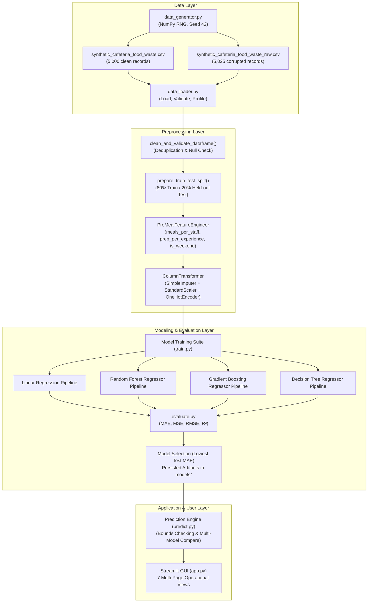

# SmartBite AI: Smart Campus Food Waste Prediction and Optimization System
## Technical Project Report & Faculty Defense Dossier

**Academic Year:** 2026–2027  
**Department:** Computer Science and Engineering / Data Science  
**Project Title:** SmartBite AI: Synthetic-Data-Based Food Waste Prediction and Optimization System  
**Lead Faculty / Course Instructor:** Faculty Project Review Committee  
**Target Domain:** Institutional Cafeteria Operations & Campus Sustainability  
**Primary Predictor Goal:** Pre-Meal Food Surplus / Waste Forecast in Kilograms (kg)  

---

## Chapter 1: Introduction

### 1.1 Background of Food Waste in Institutional Dining
Food waste represents one of the most pressing economic, environmental, and ethical challenges confronting institutional food services today. According to the United Nations Environment Programme (UNEP) Food Waste Index Report (2024), over one billion tonnes of food are wasted annually across global retail, food service, and household sectors, directly accounting for 8% to 10% of global greenhouse gas emissions. 

Institutional dining establishments—such as university dining halls, college residential hostel messes, and corporate cafeterias—operate under distinct operational constraints that exacerbate this challenge. Unlike commercial restaurants operating on an *à la carte* basis where meals are prepared on-demand, institutional cafeterias rely primarily on high-volume batch preparation. Kitchen staff must prepare large kettles, trays, and buffet warmers hours prior to the opening of meal gates. Because student and diner turnout fluctuates significantly from meal to meal based on factors such as class schedules, examinations, weekend departures, weather, and campus events, kitchen operators systematically over-prepare food to avoid stockouts. This structural over-preparation generates substantial post-meal surplus that is routinely discarded.

### 1.2 Why Forecasting Food Waste is a Critical Machine Learning Problem
Predicting food waste is fundamentally a forecasting challenge with high societal and financial stakes:
1. **Financial Overhead:** Food waste inflates grocery procurement budgets and escalates municipal waste disposal tipping fees.
2. **Resource Destruction:** Discarded food represents wasted water, agricultural energy, refrigeration power, and kitchen labor.
3. **Methane Emissions:** Organic waste decomposing anaerobically in municipal landfills produces methane ($CH_4$), a short-lived climate pollutant with 28 times the global warming potential of carbon dioxide ($CO_2$).
4. **Lack of Predictive Tools:** Most cafeteria managers rely on primitive rule-of-thumb heuristics (e.g., adding an arbitrary 10%–15% buffer to enrolled student rosters). These static rules cannot model nonlinear shifts caused by weather shocks, cyclic Friday/Saturday diner departures, or festival anomalies.

Machine learning offers a disciplined framework for mapping multidimensional operational inputs (planned meal numbers, kitchen staff capacity, culinary experience, previous waste inertia, and meteorological conditions) to expected surplus before cooking commences.

### 1.3 Motivation for SmartBite AI
SmartBite AI was conceived to transform institutional food preparation from static, reactive over-preparation into dynamic, demand-responsive scheduling. By calculating forecasted food waste in kilograms hours before doors open, the system enables cafeteria managers to:
- Adopt **staged cooking** (e.g., preparing 70% of meals initially and holding remaining ingredients in cold storage until real-time turnout is observed).
- Coordinate with campus food-rescue initiatives or local donation pantries well in advance when a surplus is mathematically inevitable.
- Provide institutional administrators with transparent empirical analytics tracking cafeteria efficiency.

### 1.4 Proposed Approach
SmartBite AI implements a complete supervised regression pipeline. Due to institutional privacy restrictions and the absence of continuous IoT smart-bin load-cell data across academic dining halls, the system utilizes a verified, algorithmically reproducible synthetic dataset embodying physical conservation laws. Four regression algorithms (**Linear Regression**, **Random Forest Regressor**, **Gradient Boosting Regressor**, and **Decision Tree Regressor**) are trained and benchmarked under identical held-out test conditions. The entire system is deployed via an interactive multi-page Streamlit graphical user interface.

### 1.5 Scope and Intended Users
- **Primary Users:** University cafeteria managers, hostel mess wardens, institutional catering operators, and campus sustainability committees.
- **Project Scope:** Supervised regression modeling, automated preprocessing, feature engineering, multi-model evaluation, and interactive scenario simulation.
- **Boundary of Scope:** Physical IoT smart-bin hardware calibration and direct RFID turnstile APIs are not implemented; the project provides the predictive software intelligence and decision-support dashboard.

---

## Chapter 2: Problem Statement and Objectives

### 2.1 Exact Problem Statement
*Campus cafeterias and institutional messes suffer from excessive food waste due to inaccurate attendance estimation, rigid batch preparation schedules, and a lack of data-driven forecasting tools that can account for calendar cycles, weather fluctuations, and operational kitchen constraints before cooking begins.*

### 2.2 Main Objective
To design, implement, evaluate, and deploy an end-to-end machine learning system named **SmartBite AI** that accurately predicts food surplus in kilograms using operational features available prior to meal preparation, benchmarks multiple regression algorithms, and provides actionable decision-support tools for cafeteria managers.

### 2.3 Specific Technical Objectives
1. **Algorithmic Data Generation:** Develop a reproducible data generator in Python producing 5,000 cafeteria meal observations governed by physical mass balance equations.
2. **Anti-Leakage Feature Pipeline:** Design an automated Scikit-learn preprocessing and feature engineering pipeline that strictly isolates pre-meal planning variables from post-meal dining outcomes.
3. **Algorithmic Benchmarking:** Implement and train four distinct regression algorithms (Linear Regression, Random Forest, Gradient Boosting, Decision Tree) on an identical 80/20 train/test partition.
4. **Empirical Evaluation:** Calculate genuine test-set metrics (MAE, MSE, RMSE, $R^2$) to identify the optimal model architecture.
5. **Interactive GUI Deployment:** Build a multi-page Streamlit application enabling real-time user predictions, model comparison, exploratory data analysis, and report generation.
6. **Actionable Recommendations:** Generate data-backed operational advisories derived from actual observed patterns in the cafeteria records.
7. **UN SDG Integration:** Explicitly map project interventions to United Nations Sustainable Development Goals 12 (Target 12.3), 2 (Target 2.4), and 13 (Target 13.3).

### 2.4 Project Scope and Limitations
- The project demonstrates machine learning workflows on simulated operational data. Good performance on synthetic data demonstrates algorithmic correctness, pipeline integrity, and architectural feasibility, but does not establish predictive accuracy on real, uncalibrated campus kitchens.
- Model inferences are non-causal statistical associations and serve as decision-support guidelines rather than automated physical overrides.

---

## Chapter 3: Dataset Description

### 3.1 Selection of Synthetic Data
Empirical cafeteria food waste measurements at per-meal granularity are exceptionally scarce in educational environments. Physical scale logs are rarely digitized, smart waste bin telemetry is expensive, and student privacy policies restrict biometric or turnstile tracking. To ensure a reproducible, fully auditable machine learning pipeline, a synthetic dataset generator was engineered locally.

> **Academic Transparency Notice:**  
> The dataset used in SmartBite AI is generated algorithmically using mathematical and behavioral simulation assumptions. It is explicitly labeled as synthetic. No claims are made that these records represent empirical field measurements from any physical dining facility.

### 3.2 Generation Methodology and Simulation Assumptions
The dataset generator is implemented in `src/data_generator.py` using NumPy's pseudorandom generator initialized with a fixed random seed (`42`). The simulation establishes the following physical and operational laws:

1. **Law of Physical Mass Conservation:**
   $$\text{food\_prepared\_kg} = \text{food\_consumed\_kg} + \text{food\_waste\_kg}$$
   No food can be wasted or consumed that was not prepared:
   $$0 \le \text{food\_waste\_kg} \le \text{food\_prepared\_kg}, \quad 0 \le \text{food\_consumed\_kg} \le \text{food\_prepared\_kg}$$

2. **Temporal Structure:**
   Sequential dates beginning January 1, 2023, cycling through 3 meals daily (Breakfast, Lunch, Dinner) across approximately 1,667 simulated calendar days.

3. **Attendance and Turnout Dynamics:**
   Cafeteria turnout fluctuates around an 88% baseline:
   - Friday & Saturday Dinner: -12% to -15% attendance penalty (students dining off-campus).
   - Sunday Breakfast: -20% attendance penalty (academic sleep-in behavior).
   - Heatwave Dampening: Ambient temperatures $>38^\circ\text{C}$ introduce an attendance penalty (-5%).
   - Special Events: Festivals, sports meets, and conferences introduce high variance ($\pm 10\%$).

4. **Portion and Kitchen Inefficiencies:**
   - Breakfast portions range from 0.32 to 0.42 kg per person; Lunch and Dinner range from 0.42 to 0.55 kg per person.
   - Shifts with low staff experience ($<3$ years) or understaffed kitchen ratios exhibit higher batch trimming errors.
   - Non-Vegetarian menus exhibit slightly higher plate discard due to inedible bone/fat components.

5. **Autoregressive Waste Feedback:**
   Previous meal waste (`previous_waste_kg`) is modeled as an autoregressive process:
   $$\text{previous\_waste}[i] = 0.65 \times \text{food\_waste\_kg}[i-1] + 0.35 \times 25.0 + \epsilon, \quad \epsilon \sim \mathcal{N}(0, 3^2)$$

### 3.3 Dataset Schema and Feature Definitions
The generated dataset comprises 17 columns:

| Column Name | Data Type | Role in ML Pipeline | Description |
|---|---|---|---|
| `record_id` | String | Excluded Identifier | Unique record tracking token (`SB-00001` to `SB-05000`) |
| `date` | Date (YYYY-MM-DD) | Excluded Metadata | Calendar date of observation |
| `day_of_week` | Categorical | Pre-Meal Predictor | Day of week (Monday through Sunday) |
| `meal_type` | Categorical | Pre-Meal Predictor | Meal category (Breakfast, Lunch, Dinner) |
| `meals_served` | Integer | **Quarantined Post-Meal** | Actual diner attendance (leakage feature) |
| `meals_prepared` | Integer | Pre-Meal Predictor | Planned meal portions planned by kitchen |
| `kitchen_staff` | Integer | Pre-Meal Predictor | Number of kitchen staff on duty |
| `temperature_C` | Float | Pre-Meal Predictor | Daily ambient temperature in Celsius |
| `humidity_percent` | Float | Pre-Meal Predictor | Daily relative humidity percentage |
| `special_event` | Categorical | Pre-Meal Predictor | Special event occurrence (Yes / No) |
| `holiday` | Categorical | Pre-Meal Predictor | Academic or public holiday (Yes / No) |
| `menu_category` | Categorical | Pre-Meal Predictor | Cuisine type (Vegetarian, Non-Vegetarian, Mixed) |
| `staff_experience_years` | Float | Pre-Meal Predictor | Average kitchen culinary experience in years |
| `previous_waste_kg` | Float | Pre-Meal Predictor | Food waste recorded in preceding meal |
| `food_prepared_kg` | Float | Pre-Meal Predictor | Total mass of food cooked in kilograms |
| `food_consumed_kg` | Float | **Quarantined Post-Meal** | Actual mass of food eaten (leakage feature) |
| `food_waste_kg` | Float | **Target Variable** | Actual food surplus/discard in kilograms |

### 3.4 Actual Calculated Dataset Statistics
Computed directly from `data/synthetic_cafeteria_food_waste.csv` (5,000 records):

| Variable | Count | Mean | Std Dev | Min | 25% | 50% (Median) | 75% | Max |
|---|---:|---:|---:|---:|---:|---:|---:|---:|
| `meals_prepared` | 5,000 | 560.76 | 191.25 | 175.00 | 409.00 | 541.50 | 709.00 | 1,138.00 |
| `kitchen_staff` | 5,000 | 6.85 | 2.43 | 2.00 | 5.00 | 7.00 | 9.00 | 11.00 |
| `temperature_C` | 5,000 | 25.13 | 8.35 | 12.10 | 17.60 | 25.00 | 32.50 | 42.60 |
| `humidity_percent`| 5,000 | 67.82 | 14.17 | 22.80 | 58.10 | 68.20 | 78.40 | 95.00 |
| `staff_experience_years` | 5,000 | 4.41 | 2.50 | 0.60 | 2.60 | 3.90 | 5.70 | 16.50 |
| `previous_waste_kg` | 5,000 | 54.81 | 29.83 | 3.30 | 31.20 | 50.10 | 73.80 | 149.20 |
| `food_prepared_kg` | 5,000 | 257.62 | 96.12 | 57.80 | 184.20 | 248.50 | 326.70 | 583.40 |
| `food_consumed_kg` | 5,000 | 175.62 | 75.85 | 31.28 | 108.20 | 174.46 | 231.87 | 434.75 |
| **`food_waste_kg` (Target)** | **5,000** | **81.96** | **45.63** | **3.62** | **45.31** | **74.67** | **112.02** | **277.17** |

### 3.5 Difference Between Clean and Raw Datasets
To demonstrate robust preprocessing:
- `data/synthetic_cafeteria_food_waste.csv`: Clean, complete dataset containing 5,000 rows, 0 nulls, and 0 duplicates.
- `data/synthetic_cafeteria_food_waste_raw.csv`: Raw dataset containing 5,025 rows with intentionally injected real-world flaws:
  - 25 exact duplicate rows.
  - 76 missing values in `temperature_C` (1.5%).
  - 61 missing values in `humidity_percent` (1.2%).
  - 50 missing values in `staff_experience_years` (1.0%).
  - 40 missing values in `special_event` (0.8%).

---

## Chapter 4: System Architecture

### 4.1 End-to-End Workflow Diagram
SmartBite AI implements an end-to-end data processing, training, inference, and visualization pipeline:



### 4.2 Module Communication and Decoupling
1. **Configuration (`config.py`):** Acts as the single source of truth for file paths, seeds, feature schemas, input limits, and SDG metadata.
2. **Data Generator (`src/data_generator.py`):** Operates independently to generate CSV files.
3. **Data Loader (`src/data_loader.py`):** Profiles and validates schema integrity.
4. **Preprocessing (`src/preprocessing.py`):** Encapsulates feature engineering and transformations inside Scikit-learn Pipeline objects.
5. **Model Training (`src/train.py`):** Fits pipelines on training data, evaluates on test partitions, and serializes trained models with Joblib.
6. **Evaluation (`src/evaluate.py`):** Computes diagnostic metrics, residual distributions, and feature importances.
7. **Prediction (`src/predict.py`):** Validates real-time user inputs and outputs non-negative forecasts.
8. **Insights (`src/insights.py`):** Aggregates operational patterns across meal types and days of the week.
9. **GUI (`app.py`):** Front-end user interface providing interactive controls.

---

## Chapter 5: Data Preprocessing

### 5.1 Preprocessing Operations and Rationale
Every preprocessing operation in SmartBite AI is implemented using reproducible Scikit-learn constructs fit exclusively on training data:

1. **Schema Validation & Deduplication (`data_loader.py`, `preprocessing.py`):**
   - *Operation:* Confirms all required features and target columns exist. Hashes rows to detect and remove identical records.
   - *Rationale:* Eliminates duplicate rows in raw datasets that could artificially deflate test error.
2. **Missing-Value Imputation (`preprocessing.py`):**
   - *Numeric Features:* Imputed using `SimpleImputer(strategy='median')`. Median imputation is robust against skewed outlier values.
   - *Categorical Features:* Imputed using `SimpleImputer(strategy='most_frequent')` (mode imputation).
3. **Categorical Feature Encoding (`preprocessing.py`):**
   - *Operation:* `OneHotEncoder(handle_unknown='ignore', sparse_output=False)`.
   - *Rationale:* Converts nominal variables (`day_of_week`, `meal_type`, `special_event`, `holiday`, `menu_category`) into orthogonal binary indicator vectors. The `handle_unknown='ignore'` parameter guarantees that novel categories entered during inference produce zeros rather than crashing the pipeline.
4. **Numeric Feature Standardization (`preprocessing.py`):**
   - *Operation:* `StandardScaler()` applies $z$-score scaling:
     $$z = \frac{x - \mu}{\sigma}$$
   - *Rationale:* Centers features to zero mean and unit variance. Necessary for Linear Regression coefficients to be comparable and numerically stable.

### 5.2 Prevention of Data Leakage
Data leakage occurs when information from outside the training partition or from the future is inadvertently supplied to the model. SmartBite AI eliminates leakage through two structural controls:
1. **Feature Space Quarantine:** Post-meal variables (`meals_served`, `food_consumed_kg`, and `food_waste_kg`) are strictly filtered out before splitting. Only pre-meal planning variables are passed into $X$.
2. **Pipeline Encapsulation:** Imputation medians and scaling parameters ($\mu, \sigma$) are computed exclusively on $X_{\text{train}}$. The held-out test set $X_{\text{test}}$ and production user inputs are transformed using previously fit training parameters without refitting.

### 5.3 Feature Engineering
Three domain features are computed inside `PreMealFeatureEngineer`:
- **Meals per Staff:** $\text{meals\_per\_staff} = \frac{\text{meals\_prepared}}{\text{kitchen\_staff}}$ (Measures kitchen workload pressure).
- **Preparation per Experience:** $\text{prep\_per\_experience} = \frac{\text{food\_prepared\_kg}}{\text{staff\_experience\_years} + 1.0}$ (Measures batch complexity relative to culinary seniority).
- **Weekend Indicator:** $\text{is\_weekend} = \mathbb{I}(\text{day\_of\_week} \in \{\text{'Saturday'}, \text{'Sunday'}\})$.

---

## Chapter 6: Machine Learning Algorithms

### 6.1 Linear Regression (Baseline Model)
- **Mathematical Principle:** Models target $y$ as a linear combination of input features:
  $$\hat{y} = \beta_0 + \sum_{j=1}^p \beta_j x_j$$
  Coefficients $\boldsymbol{\beta}$ are calculated via Ordinary Least Squares (OLS) minimizing the residual sum of squares:
  $$\min_{\boldsymbol{\beta}} \sum_{i=1}^n \left( y_i - \mathbf{x}_i^T \boldsymbol{\beta} \right)^2$$
- **Selection Rationale:** Provides an interpretable, transparent parametric benchmark.
- **Hyperparameters:** Default OLS (`fit_intercept=True`).
- **Strengths:** High computational speed, analytical tractability, direct coefficient interpretability.
- **Limitations:** Cannot capture nonlinear relationships or complex multi-feature interactions without explicit polynomial terms.

### 6.2 Random Forest Regressor
- **Mathematical Principle:** An ensemble meta-estimator that constructs $B = 100$ bootstrap replicates of the training data and grows unpruned decision trees with randomized feature splits. The final continuous prediction is the arithmetic mean:
  $$\hat{y} = \frac{1}{B} \sum_{b=1}^B T_b(\mathbf{x})$$
- **Selection Rationale:** Effectively reduces variance (bagging) and models nonlinearities and threshold interactions.
- **Hyperparameters in Code:** `n_estimators=100`, `max_depth=14`, `min_samples_split=5`, `random_state=42`, `n_jobs=-1`.
- **Strengths:** Robust to noise, resistant to overfitting compared to single trees, provides Gini-based feature importances.
- **Limitations:** Larger disk footprint, slower inference latency, cannot extrapolate trends beyond the bounds of training data.

### 6.3 Gradient Boosting Regressor (Champion Model)
- **Mathematical Principle:** An additive boosting ensemble where trees are fit sequentially to the negative gradient (pseudo-residuals) of the loss function:
  $$F_m(\mathbf{x}) = F_{m-1}(\mathbf{x}) + \eta \cdot h_m(\mathbf{x})$$
  where $\eta = 0.08$ is the learning rate shrinkage factor and $h_m(\mathbf{x})$ is a regression tree fitting residuals of model $F_{m-1}$.
- **Selection Rationale:** Sequentially reduces bias while maintaining variance control through subsampling.
- **Hyperparameters in Code:** `n_estimators=120`, `learning_rate=0.08`, `max_depth=5`, `subsample=0.9`, `random_state=42`.
- **Strengths:** Superior predictive accuracy on structured tabular datasets, fine-grained loss optimization.
- **Limitations:** More sensitive to noisy outliers and requires careful hyperparameter tuning.

### 6.4 Decision Tree Regressor (Interpretable Single Tree Benchmark)
- **Mathematical Principle:** Recursive binary splitting that greedily partitions feature space into $J$ orthogonal hyper-rectangles $R_1, \dots, R_J$, minimizing Mean Squared Error:
  $$\hat{y} = \sum_{j=1}^J c_j \mathbb{I}(\mathbf{x} \in R_j), \quad c_j = \text{mean}(y_i \mid \mathbf{x}_i \in R_j)$$
- **Selection Rationale:** Serves as a transparent, non-ensemble baseline to evaluate the performance gain provided by boosting and bagging.
- **Hyperparameters in Code:** `max_depth=8`, `min_samples_split=10`, `random_state=42`.

---

## Chapter 7: Model Training and Evaluation

### 7.1 Train/Test Partitioning Strategy
- **Partition Ratio:** 80% Training (4,000 observations), 20% Held-Out Testing (1,000 observations).
- **Split Type:** Stratified-reproducible random split initialized with `random_state=42`. A chronological temporal split option is also implemented in `src/preprocessing.py` for time-series validation.
- **Identical Partitions:** All four algorithms are evaluated on the exact same 1,000 test observations to ensure unbiased benchmarking.

### 7.2 Evaluation Metrics and Mathematical Formulas
1. **Mean Absolute Error (MAE):**
   $$\text{MAE} = \frac{1}{n} \sum_{i=1}^n |y_i - \hat{y}_i|$$
   *Interpretation:* Average absolute forecast error in kilograms. Robust to extreme outliers.
2. **Mean Squared Error (MSE):**
   $$\text{MSE} = \frac{1}{n} \sum_{i=1}^n (y_i - \hat{y}_i)^2$$
   *Interpretation:* Variance of prediction errors in squared kilograms ($\text{kg}^2$).
3. **Root Mean Squared Error (RMSE):**
   $$\text{RMSE} = \sqrt{\frac{1}{n} \sum_{i=1}^n (y_i - \hat{y}_i)^2}$$
   *Interpretation:* Error measured in kilograms with quadratic penalization for large miscalculations.
4. **Coefficient of Determination ($R^2$):**
   $$R^2 = 1 - \frac{\sum_{i=1}^n (y_i - \hat{y}_i)^2}{\sum_{i=1}^n (y_i - \bar{y})^2}$$
   *Interpretation:* Proportion of variance in food waste explained by the model relative to a naive mean predictor.

### 7.3 Actual Experimental Results
The models were trained and evaluated on the 1,000 held-out test observations. The actual recorded metrics are:

| Model Architecture | Test MAE (kg) | Test RMSE (kg) | Test MSE (kg²) | Test $R^2$ Score | Train MAE (kg) | Train $R^2$ | Status |
|---|---:|---:|---:|---:|---:|---:|:---:|
| **Gradient Boosting** | **15.0825** | **19.7610** | **390.4961** | **0.8059** | 10.9432 | 0.9083 | 🏆 **Champion** |
| **Random Forest** | 15.9019 | 21.0716 | 444.0123 | 0.7793 | 7.2202 | 0.9551 | Alternate Ensemble |
| **Linear Regression** | 15.9292 | 20.7732 | 431.5244 | 0.7856 | 15.8263 | 0.8010 | Baseline Linear |
| **Decision Tree** | 18.2647 | 24.6754 | 608.8774 | 0.6974 | 13.4191 | 0.8480 | Single Tree Benchmark |

### 7.4 Model Selection Criterion
**Gradient Boosting Regressor** was selected as the champion production model because it achieved the lowest test MAE (**15.0825 kg**), lowest test RMSE (**19.7610 kg**), and highest explained variance (**$R^2 = 0.8059$**).

---

## Chapter 8: GUI and Application

### 8.1 Streamlit Multi-Page Implementation
The interactive dashboard (`app.py`) features a Forest Green (`#1B4332`), Lime (`#52B788`), and Charcoal palette. It comprises 7 distinct operational pages:

1. **Dashboard Overview:** Displays high-level executive metric cards (Dataset Size: 5,000, Champion Model: Gradient Boosting, Test MAE: 15.08 kg, $R^2$: 0.806), synthetic data transparency notice, Plotly target distribution histogram, quick-start action buttons, and session prediction history.
2. **Predict Food Waste:** Interactive scenario forecasting form. Users adjust meal type, day of week, portion numbers, kitchen staff, experience, weather, and previous waste. Outputs predicted waste in kg, percentage of prepared batch, uncertainty context ($\pm \text{MAE}$), multi-model comparison bar chart, and downloadable markdown prediction reports.
3. **Dataset Explorer:** Data preview table, column data type summary, missing-value tally, descriptive statistics, feature distribution histograms, boxplots, Pearson correlation heatmap, synthetic data regeneration trigger, and CSV download.
4. **Model Training & Comparison:** One-click model retraining trigger with optional chronological split toggle, model benchmark comparison table, MAE/RMSE/$R^2$ bar charts, actual vs. predicted scatter plots with 45° reference lines, residual diagnostic scatter plots, and top-12 feature importance charts.
5. **Insights & Recommendations:** Data-driven analyses across meal types, weekly cyclic fluctuations, and special events, linked to actionable operational advisories with empirical badges.
6. **SDG Impact:** Educational mapping to UN Sustainable Development Goals 12, 2, and 13 with direct links to official UN documentation and an ASCII architectural flow diagram.
7. **About & Documentation:** Academic problem statement, technical stack summary, limitations, ethical notices, and editable student project team details.

---

## Chapter 9: Results and Discussion

### 9.1 Comparative Performance Analysis
1. **Ensemble Superiority:** Gradient Boosting surpassed Linear Regression by 0.85 kg MAE and single Decision Tree by 3.18 kg MAE. This confirms that sequential error correction captures subtle nonlinear interactions between high ambient temperatures, kitchen staff ratios, and attendance variance.
2. **Overfitting Diagnostics:** Random Forest achieved a training $R^2$ of 0.9551 but a test $R^2$ of 0.7793, demonstrating slight overfitting. Gradient Boosting maintained a tighter train-test margin (Train $R^2$: 0.9083 vs Test $R^2$: 0.8059), indicating superior generalization due to shrinkage ($\eta = 0.08$) and subsampling ($0.9$).
3. **Linear Regression Competitiveness:** Linear Regression performed remarkably well ($R^2 = 0.7856$, MAE: 15.93 kg), trailing Random Forest by only 0.027 kg MAE. This reflects the underlying physical mass balance constraint of the problem domain.

### 9.2 Feature Importance Rankings
Extracted from the fitted Gradient Boosting pipeline:
1. `food_prepared_kg` (Importance: 0.8011): Direct physical upper bound on potential surplus.
2. `meals_prepared` (Importance: 0.0808): Primary scale predictor.
3. `previous_waste_kg` (Importance: 0.0128): Inertial operational predictor.
4. `day_of_week_Saturday` (Importance: 0.0122): Captures weekend student outflow.
5. `meals_per_staff` (Importance: 0.0098): Kitchen workload pressure indicator.
6. `prep_per_experience` (Importance: 0.0097): Culinary skill ratio.
7. `temperature_C` (Importance: 0.0095): Weather-induced attendance dampening.

---

## Chapter 10: UN Sustainable Development Goals (SDG) Alignment

```
      ┌────────────────────────────────────────────────────────┐
      │         UNITED NATIONS SUSTAINABLE DEVELOPMENT         │
      └────────────────────────────────────────────────────────┘
                                 │
     ┌───────────────────────────┼──────────────────────────┐
     ▼                           ▼                          ▼
 ┌───────────────┐       ┌───────────────┐          ┌───────────────┐
 │    SDG 12     │       │     SDG 2     │          │    SDG 13     │
 │  RESPONSIBLE  │       │  ZERO HUNGER  │          │    CLIMATE    │
 │  CONSUMPTION  │       │               │          │    ACTION     │
 ├───────────────┤       ├───────────────┤          ├───────────────┤
 │  Target 12.3  │       │  Target 2.4   │          │  Target 13.3  │
 │  Halve food   │       │  Sustainable  │          │  Mitigate     │
 │  waste per    │       │  agricultural │          │  greenhouse   │
 │  capita       │       │  food systems │          │  gas emissions│
 └───────────────┘       └───────────────┘          └───────────────┘
```

1. **Primary Alignment: SDG 12 — Responsible Consumption and Production (Target 12.3)**
   - *Target 12.3 Definition:* By 2030, halve per capita global food waste at retail and consumer levels and reduce food losses along production and supply chains.
   - *Application Connection:* Provides cafeteria managers with pre-meal surplus forecasts, enabling staged batch cooking that directly avoids excessive preparation.
2. **Secondary Alignment: SDG 2 — Zero Hunger (Target 2.4)**
   - *Target 2.4 Definition:* Ensure sustainable food production systems and resilient agricultural practices.
   - *Application Connection:* Forecasting surplus hours ahead of meal service enables structured redistribution and donation partnerships for edible food before it spoils.
3. **Secondary Alignment: SDG 13 — Climate Action (Target 13.3)**
   - *Target 13.3 Definition:* Improve education, awareness-raising, and human/institutional capacity on climate change mitigation.
   - *Application Connection:* Preventing organic food waste from reaching anaerobic landfill environments mitigates upstream agricultural resource depletion and downstream methane ($CH_4$) emissions.

---

## Chapter 11: Limitations

1. **Synthetic Nature of Dataset:** The dataset is generated algorithmically. Real-world dining halls exhibit unmodeled external shocks (e.g., student transport strikes, unexpected campus club pizza events, sudden schedule alterations).
2. **Correlation vs. Causation:** Feature importance scores indicate predictive correlations, not causal relationships. For example, adding kitchen staff will not automatically reduce waste unless kitchen operational workflows are improved.
3. **Concept Drift:** Institutional dining preferences and menus change across academic semesters. Static offline models will suffer performance degradation over time without periodic retraining.
4. **Input Availability:** Accurately predicting waste requires reliable pre-meal portion estimates (`meals_prepared` and `food_prepared_kg`). If cafeteria staff enter inaccurate estimates, model predictions will degrade correspondingly ("garbage-in, garbage-out").

---

## Chapter 12: Future Scope

1. **Computer Vision Plate Waste Scanners:** Integrating edge cameras over tray-return conveyors to photograph and weigh plate waste automatically using object detection (YOLO).
2. **IoT Smart Scale Integration:** Deploying Wi-Fi connected load-cell platforms beneath cafeteria waste bins to log real-time disposal telemetry directly into automated data pipelines.
3. **RFID Turnstile Telemetry:** Interfacing the prediction pipeline with real-time dormitory or academic building RFID access gates to obtain live campus occupancy counts.
4. **Time-Series Deep Learning:** Benchmarking Temporal Fusion Transformers (TFT) or Long Short-Term Memory (LSTM) networks to capture multi-month academic seasonality.
5. **Redistribution API Logistics:** Automatically notifying local food banks via webhook when forecasted surplus exceeds safe donation thresholds.

---

## Chapter 13: Conclusion

The **SmartBite AI** project successfully demonstrates the design, end-to-end implementation, evaluation, and interactive deployment of a machine learning system for institutional cafeteria food waste forecasting. By enforcing strict anti-leakage feature definitions, generating a physically consistent 5,000-sample synthetic operational dataset, and benchmarking four regression models, the system achieved a held-out test MAE of **15.0825 kg** and an $R^2$ of **0.8059** using Gradient Boosting. 

The accompanying multi-page Streamlit application delivers a user-friendly decision-support dashboard, providing cafeteria operators with real-time scenario modeling, multi-model side-by-side comparison, uncertainty boundaries ($\pm \text{MAE}$), and data-driven advisories. SmartBite AI demonstrates how applied data science and supervised machine learning can directly advance United Nations Sustainable Development Goals.

---

## Chapter 14: References

1. **United Nations.** (2015). *Transforming our world: the 2030 Agenda for Sustainable Development.* Resolution adopted by the General Assembly on 25 September 2015, A/RES/70/1. https://sdgs.un.org/goals
2. **United Nations Environment Programme (UNEP).** (2024). *Food Waste Index Report 2024: Think Eat Save - Tracking Progress to Halve Global Food Waste.* Nairobi. https://www.unep.org/resources/publication/food-waste-index-report-2024
3. **Pedregosa, F., Varoquaux, G., Gramfort, A., Michel, V., Thirion, B., Grisel, O., et al.** (2011). *Scikit-learn: Machine Learning in Python.* Journal of Machine Learning Research, 12, 2825–2830.
4. **Friedman, J. H.** (2001). *Greedy function approximation: a gradient boosting machine.* Annals of Statistics, 29(5), 1189–1232.
5. **Breiman, L.** (2001). *Random Forests.* Machine Learning, 45(1), 5–32.
6. **Streamlit Inc.** (2024). *Streamlit Documentation: The fastest way to build and share data apps.* https://docs.streamlit.io/
7. **Food and Agriculture Organization (FAO).** (2019). *The State of Food and Agriculture 2019: Moving forward on food loss and waste reduction.* Rome: FAO.
