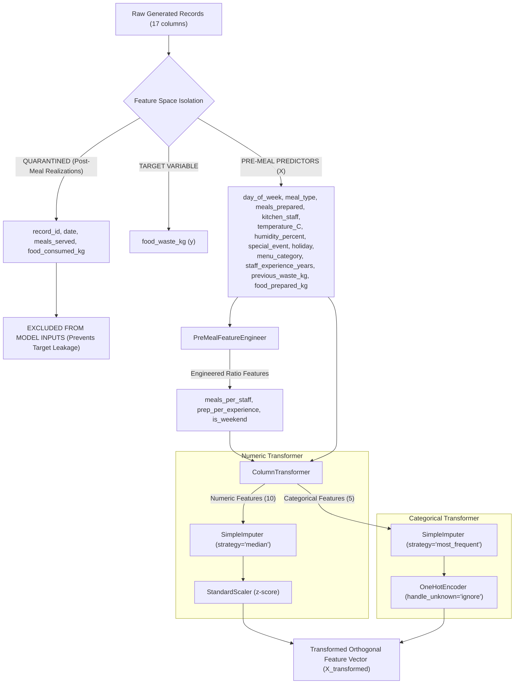
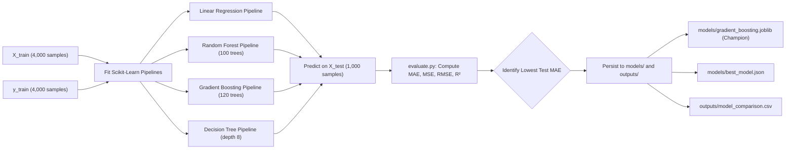
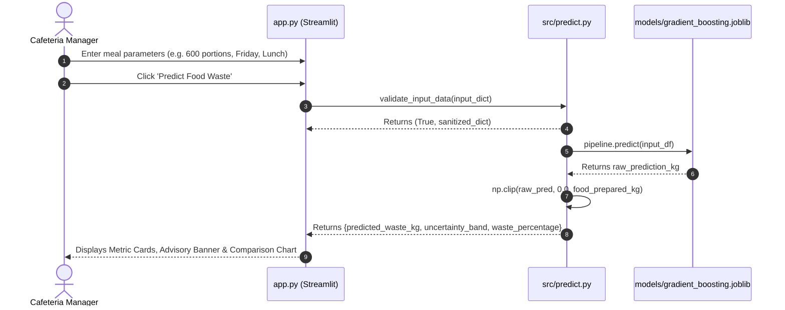

# SmartBite AI: Technical Architecture and System Design Document
## Complete Architectural Specification, Data Flows, and Module Reference

This document provides a comprehensive technical overview of the software engineering, machine learning pipelines, and component interrelationships implemented in the **SmartBite AI** repository.

---

## 1. Actual Directory Structure

The repository is structured following modular Python design patterns:

```text
c:\Users\Akansha\Desktop\dsml project\
├── app.py                     # Streamlit multi-page web application entrypoint
├── config.py                  # Central configuration, schemas, bounds, and SDG metadata
├── requirements.txt           # Verified Python package dependencies
├── README.md                  # Project overview and execution instructions
├── report.md                  # Comprehensive academic project report
├── .gitignore                 # Version control hygiene rules
├── data/
│   ├── README.md              # Dataset schema, assumptions, and synthetic disclosure
│   ├── synthetic_cafeteria_food_waste.csv      # Clean validated dataset (5,000 rows)
│   └── synthetic_cafeteria_food_waste_raw.csv  # Raw dataset with anomalies (5,025 rows)
├── faculty_report/
│   ├── Project_Report.md      # Full 14-chapter academic defense report
│   ├── Project_Explanation.md # 19-point beginner-friendly technical explanation
│   ├── Viva_Questions_and_Answers.md # 45 high-probability faculty exam Q&As
│   ├── Presentation_Speech.md # 5–7 minute scripted oral presentation
│   ├── Project_Demo_Guide.md  # Step-by-step interactive live demo plan
│   ├── Technical_Architecture.md # System architecture and data flow document
│   └── Project_Status_and_Evidence.md # Verification matrix and empirical proof
├── models/
│   ├── README.md              # Persistence protocol documentation
│   ├── best_model.json        # Champion model metadata and selection rationale
│   ├── evaluation_metrics.json# Full train/test evaluation metrics and feature importances
│   ├── test_predictions_sample.json # Cache of test predictions for GUI charting
│   ├── gradient_boosting.joblib # Serialized Gradient Boosting Pipeline
│   ├── random_forest.joblib   # Serialized Random Forest Pipeline
│   ├── linear_regression.joblib # Serialized Linear Regression Pipeline
│   └── decision_tree.joblib   # Serialized Decision Tree Pipeline
├── outputs/
│   ├── README.md              # Documentation of generated reports
│   └── model_comparison.csv   # Persisted tabular benchmark
├── src/
│   ├── __init__.py            # Module namespace declaration
│   ├── data_generator.py      # Algorithmic synthetic dataset generator
│   ├── data_loader.py         # Data loading, validation, and profiling
│   ├── preprocessing.py       # Custom transformers, pipelines, and train/test splitting
│   ├── train.py               # Multi-model training and persistence pipeline
│   ├── evaluate.py            # Metric computation and feature importance extraction
│   ├── predict.py             # Pre-meal inference engine with bounds checking
│   └── insights.py            # Operational patterns and data-backed recommendations
└── tests/
    ├── test_data_generator.py # Unit tests for data generation and mass conservation
    ├── test_preprocessing.py  # Unit tests for anti-leakage isolation and imputation
    ├── test_training.py       # Unit tests for training pipeline and metrics
    └── test_prediction.py     # Unit tests for input validation and inference
```

---

## 2. Module Purpose and Component Communication

The system enforces strict separation of concerns:

```
┌────────────────────────────────────────────────────────┐
│                       config.py                        │
│   (Paths, Feature Schemas, Bounds, Seeds, SDG Data)    │
└────────────────────────────────────────────────────────┘
          ▲                   ▲                   ▲
          │                   │                   │
┌──────────────────┐ ┌──────────────────┐ ┌──────────────────┐
│data_generator.py │ │ preprocessing.py │ │    train.py      │
└──────────────────┘ └──────────────────┘ └──────────────────┘
          │                   │                   │
          ▼                   ▼                   ▼
┌──────────────────┐ ┌──────────────────┐ ┌──────────────────┐
│  data_loader.py  │ │   evaluate.py    │ │    predict.py    │
└──────────────────┘ └──────────────────┘ └──────────────────┘
          │                   │                   │
          └───────────────────┼───────────────────┘
                              ▼
                     ┌──────────────────┐
                     │      app.py      │
                     │  (Streamlit GUI) │
                     └──────────────────┘
```

1. **`config.py`:** Centralized constants module. Exports filesystem paths (`DATA_DIR`, `MODELS_DIR`, `OUTPUTS_DIR`), feature lists (`ALL_PREDICTOR_FEATURES`, `LEAKAGE_TARGET_FEATURES`), input validation ranges (`FEATURE_RANGES`), categorical options, and UN SDG metadata.
2. **`src/data_generator.py`:** Generates reproducible synthetic cafeteria records using NumPy seed 42. Outputs clean (`synthetic_cafeteria_food_waste.csv`) and raw datasets.
3. **`src/data_loader.py`:** Loads CSV files with automatic fallback to data generation if files are missing. Profiles missing counts, duplicate counts, and schema validation.
4. **`src/preprocessing.py`:** Houses `PreMealFeatureEngineer` and `build_preprocessor()`. Combines numerical median imputation, categorical mode imputation, one-hot encoding, and standard scaling into reusable Scikit-learn Pipeline objects.
5. **`src/train.py`:** Main training orchestrator. Splits data into 80% train and 20% test, fits 4 regression pipelines, computes evaluation metrics, serializes `.joblib` model artifacts to `models/`, and generates `outputs/model_comparison.csv`.
6. **`src/evaluate.py`:** Calculates MAE, MSE, RMSE, and $R^2$ on held-out test predictions. Extracts feature importances and coefficient tables.
7. **`src/predict.py`:** Production inference engine. Performs input schema and boundary validation, loads serialized pipelines, clips output within $[0, \text{food\_prepared\_kg}]$, and exports markdown reports.
8. **`src/insights.py`:** Aggregates empirical statistics across meal types, weekly cycles, and special events to generate heuristic advisories.
9. **`app.py`:** 7-page interactive Streamlit frontend communicating directly with `src/` modules in Python process memory.

---

## 3. Detailed Data and Execution Flows

### 3.1 Preprocessing and Feature Isolation Flow
To guarantee zero target leakage, features are partitioned into two strictly separated sets:



### 3.2 Training and Persistence Pipeline Flow


### 3.3 Inference Execution Flow


---

## 4. Model Persistence and Artifact Specification

All trained models are serialized as composite Scikit-learn `Pipeline` objects using `joblib`. This packages the feature engineering logic, imputation statistics, scaling factors, one-hot category dictionaries, and regression trees together in a single self-contained binary:

| Artifact Path | Format | Size | Description |
|---|---|---|---|
| `models/gradient_boosting.joblib` | Joblib Binary | ~320 KB | Champion Gradient Boosting Pipeline |
| `models/random_forest.joblib` | Joblib Binary | ~7.2 MB | 100-Tree Random Forest Pipeline |
| `models/linear_regression.joblib` | Joblib Binary | ~5 KB | Standardized OLS Linear Pipeline |
| `models/decision_tree.joblib` | Joblib Binary | ~25 KB | Single Decision Tree Pipeline |
| `models/best_model.json` | JSON | 260 B | Selection metadata and champion metrics |
| `models/evaluation_metrics.json` | JSON | 12.5 KB | Complete train/test metrics and feature importances |
| `models/test_predictions_sample.json` | JSON | 28 KB | 300-point ground truth and prediction cache for GUI |
| `outputs/model_comparison.csv` | CSV | 242 B | Persisted tabular benchmark |

---

## 5. Software Dependencies and Environment

- **Python Version:** Python 3.11+ (verified and tested on Python 3.13.7, 64-bit).
- **Core Library Dependencies:**
  - `streamlit>=1.30.0` (v1.54.0 installed)
  - `pandas>=2.0.0` (v2.3.3 installed)
  - `numpy>=1.24.0` (v2.3.5 installed)
  - `scikit-learn>=1.3.0` (v1.8.0 installed)
  - `plotly>=5.15.0` (v7.1.0 installed)
  - `matplotlib>=3.7.0` (v3.11.2 installed)
  - `seaborn>=0.12.0` (v0.13.2 installed)
  - `joblib>=1.3.0` (v1.5.2 installed)
  - `pytest>=7.4.0` (v9.1.1 installed)
  - `python-docx>=1.2.0` (v1.2.0 installed)

---

## 6. Command Reference

All operations are executed from the project root:

```powershell
# 1. Generate clean and raw synthetic datasets
python -m src.data_generator

# 2. Train all 4 models and generate comparison artifacts
python -m src.train

# 3. Execute the automated unit test suite
pytest -v

# 4. Launch the Streamlit interactive dashboard
streamlit run app.py
```
