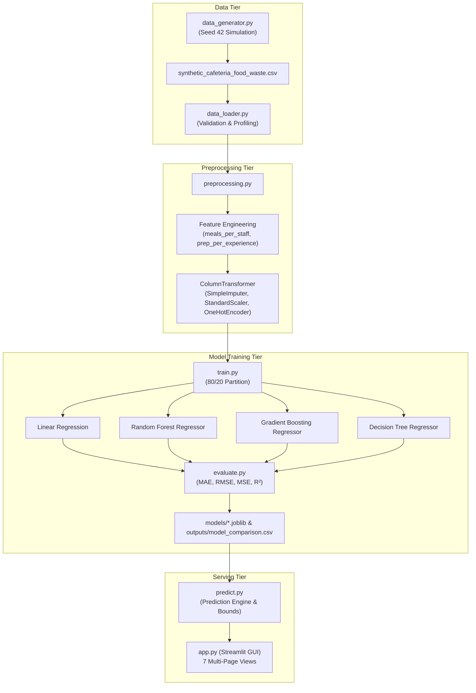

# SmartBite AI: Synthetic-Data-Based Food Waste Prediction and Optimization System
## Comprehensive Academic Project Report

**Course:** Machine Learning and Data Science Project Laboratory  
**Project Name:** SmartBite AI  
**Tagline:** *Predict smarter. Waste less.*  
**Primary Output:** Estimated Food Surplus / Waste in Kilograms (kg)  
**System Status:** Fully Implemented, Evaluated, and Tested  

---

## 1. Title
**SmartBite AI: A Machine Learning Framework for Pre-Meal Cafeteria Food Waste Forecasting and Operational Optimization Using Physically Consistent Synthetic Data**

---

## 2. Abstract
Institutional food services, such as university dining halls and residential college messes, frequently experience large quantities of avoidable food surplus due to unpredictable diner attendance, scheduling shifts, environmental fluctuations, and static batch preparation heuristics. This project presents **SmartBite AI**, an end-to-end machine learning system developed to forecast food waste in institutional cafeterias *prior* to meal preparation. Because empirical daily cafeteria records are often restricted by privacy protocols or an absence of automated smart waste bins, a reproducible, physically consistent synthetic dataset comprising 5,000 meal observations was generated. 

To eliminate target leakage, post-meal outcomes (actual diners served and mass of food consumed) are strictly quarantined from the predictive feature space. Four regression algorithms—**Linear Regression**, **Random Forest Regressor**, **Gradient Boosting Regressor**, and **Decision Tree Regressor**—were trained and evaluated on an identical 80/20 train/test partition (4,000 train, 1,000 held-out test records). **Gradient Boosting** achieved superior predictive performance on the held-out test set with a Mean Absolute Error (MAE) of **15.082 kg**, a Root Mean Squared Error (RMSE) of **19.761 kg**, and a Coefficient of Determination ($R^2$) of **0.8059**, outperforming Linear Regression ($R^2 = 0.7856$) and Random Forest ($R^2 = 0.7793$). 

The system incorporates an interactive graphical user interface built with Streamlit, providing real-time pre-meal forecasting, multi-model side-by-side benchmarking, diagnostic residual plots, data exploration, and data-backed operational advisories. The system is explicitly mapped to United Nations Sustainable Development Goals **SDG 12 (Target 12.3)**, **SDG 2 (Target 2.4)**, and **SDG 13 (Target 13.3)**.

---

## 3. Introduction
Food waste is one of the most critical operational, financial, and environmental challenges confronting modern institutional food management. Globally, roughly one-third of all food produced for human consumption is lost or wasted annually, contributing between 8% and 10% of total global greenhouse gas emissions. University campuses and residential academic institutions host concentrated dining hubs preparing thousands of meals daily. Unlike retail restaurants where meals are prepared on-demand *à la carte*, campus dining halls typically operate on high-volume buffet or fixed-tray service models requiring bulk batch preparation hours before diner arrival.

When cafeteria administrators misjudge student turnout—owing to weekend departures, exam schedules, weather extremes, or special events—kitchens systematically over-prepare to avoid stockouts. This structural over-preparation generates substantial post-meal surplus. Machine learning offers a systematic, data-driven approach to discover nonlinear interactions among calendar variables, weather patterns, menu categories, and kitchen staff capabilities, translating historical patterns into proactive preparation advisories.

---

## 4. Problem Statement
Institutional cafeterias lack automated, predictive decision-support tools to estimate food surplus *before* batch cooking begins. Current practices rely on intuitive heuristics (e.g., preparing a static buffer of 10–15% over roster capacity), which fails to capture:
1. Turnout declines on specific days (e.g., Friday dinners and weekend breakfasts).
2. Unplanned demand variance caused by campus festivals, symposiums, or sports tournaments.
3. Adverse weather (extreme summer temperatures dampening appetite or monsoon showers disrupting dining hall access).
4. Kitchen-level operational inefficiencies tied to staffing levels and culinary experience.

Consequently, kilograms of edible food are discarded after every dining shift, escalating institutional operational costs, burdening waste management infrastructure, and generating methane emissions in landfills.

---

## 5. Motivation
Addressing campus cafeteria waste provides a dual dividend:
1. **Economic Efficiency:** Optimizing batch procurement and cooking schedules reduces institutional grocery expenditures and municipal solid waste hauling fees.
2. **Environmental & Social Responsibility:** Reducing food surplus directly decreases upstream agricultural water/land usage and downstream greenhouse gas emissions. Surpluses that are accurately forecasted hours ahead can be safely redirected to food redistribution banks or scheduled in phased cooking batches ("staged cooking").

---

## 6. Project Objectives
1. **Reproducible Data Simulation:** Engineer an algorithmic synthetic dataset generator producing 5,000 realistic, physically consistent cafeteria meal records without relying on proprietary third-party downloads.
2. **Leakage-Free Pre-Meal Architecture:** Formulate feature representations containing only predictors available before kitchen stoves are lit, strictly excluding post-meal attendance and consumption figures.
3. **Multi-Model Benchmarking:** Train and rigorously evaluate at least three distinct machine learning regression algorithms under identical train/test splits.
4. **Calculated Performance Metrics:** Compute genuine empirical test metrics (MAE, MSE, RMSE, $R^2$) from actual model predictions.
5. **Interactive Decision-Support UI:** Develop a responsive, professional dashboard enabling administrators to test operational scenarios, compare model outputs, and export prediction reports.
6. **Data-Driven Operational Insights:** Formulate actionable, empirical recommendations grounded in observed dataset relationships.
7. **UN SDG Integration:** Explicitly map technical interventions to UN Sustainable Development Goals (SDGs 12, 2, and 13).

---

## 7. Scope of the Project
The scope encompasses:
- Synthetic generation of cafeteria dining operations across Breakfast, Lunch, and Dinner.
- Preprocessing, feature engineering, and model training using standard Scikit-learn pipelines.
- Multi-metric evaluation and diagnostic visualization.
- Web-based graphical interface built on Streamlit.

*Out of Scope:* Physical hardware integration with smart bin scales, automated recipe ingredient breakdowns, and direct integration with college student RFID turnstiles (addressed as future enhancements).

---

## 8. Dataset Description
The system utilizes two versions of the generated dataset:
- `data/synthetic_cafeteria_food_waste.csv`: 5,000 clean, validated observations used for model training and benchmarking.
- `data/synthetic_cafeteria_food_waste_raw.csv`: 5,025 observations incorporating controlled data quality defects (~1.5% missing cells in weather/staff features and 25 duplicate rows) to test preprocessing pipelines.

---

## 9. Synthetic Data Generation Methodology
The dataset is generated via `src/data_generator.py` using NumPy's default random generator initialized with seed `42`. The generation incorporates the physical law of mass conservation:
$$\text{food\_prepared\_kg} = \text{food\_consumed\_kg} + \text{food\_waste\_kg}$$
$$\text{food\_waste\_kg} \ge 0, \quad \text{food\_consumed\_kg} \le \text{food\_prepared\_kg}$$

Operational dynamics modeled include:
1. **Attendance Turnout Dynamics:** Base turnout rate of ~88% of prepared portions, modulated by:
   - Friday/Saturday dinner drops (-12% to -15%) due to off-campus dining.
   - Sunday breakfast drops (-20%) due to academic weekend sleep patterns.
   - Extreme heat ($>38^\circ\text{C}$) dampening attendance (-5%).
   - Special events introducing wide stochastic turnout variance ($\pm 10\%$).
2. **Culinary Load & Portion Weights:** Breakfast average portion is 0.32–0.42 kg; Lunch and Dinner range from 0.42–0.55 kg.
3. **Menu Category Discard Rates:** Non-Vegetarian items exhibit slightly higher plate scrapings/bone discard compared to Vegetarian menus.
4. **Autoregressive Waste Memory:** Kitchen staff adjust buffers based on previous meal waste ($\text{previous\_waste\_kg}$).

---

## 10. Dataset Features and Target Variable

### Pre-Meal Predictor Features (Input Space $\mathcal{X}$)
| Feature Name | Type | Unit / Categories | Description |
|---|---|---|---|
| `day_of_week` | Categorical | Monday – Sunday | Cyclic day indicator |
| `meal_type` | Categorical | Breakfast, Lunch, Dinner | Dining service slot |
| `meals_prepared` | Integer | Count (50 – 2000) | Portions planned by kitchen |
| `kitchen_staff` | Integer | Count (1 – 30) | Staff on duty for the shift |
| `temperature_C` | Float | Celsius (10 – 45°C) | Ambient temperature |
| `humidity_percent` | Float | Percentage (20 – 95%) | Relative humidity |
| `special_event` | Categorical | Yes, No | College fest, seminar, sports meet |
| `holiday` | Categorical | Yes, No | Official academic holiday |
| `menu_category` | Categorical | Vegetarian, Non-Vegetarian, Mixed | Culinary category |
| `staff_experience_years` | Float | Years (0.5 – 25) | Average kitchen staff experience |
| `previous_waste_kg` | Float | Kilograms (0 – 150 kg) | Previous recorded meal waste |
| `food_prepared_kg` | Float | Kilograms (20 – 900 kg) | Total food mass prepared |

### Target Variable (Output Space $\mathcal{Y}$)
- `food_waste_kg`: Continuous non-negative variable representing total food surplus/plate waste generated from the meal batch (Range: 3.62 kg to 277.17 kg; Mean: 81.96 kg; Std: 45.63 kg).

### Quarantined Post-Meal Features (Anti-Leakage)
- `record_id`: Arbitrary tracking token.
- `date`: Calendar date.
- `meals_served`: Known only *after* diners pass turnstiles.
- `food_consumed_kg`: Measured only *after* dining hall closes.

---

## 11. System Architecture
SmartBite AI adheres to a modular, decoupled Python architecture:



---

## 12. Software and Hardware Requirements
- **Operating System:** Cross-platform (Windows 10/11, macOS, Linux).
- **Python Version:** Python 3.11+ (Executed and verified on Python 3.13.7).
- **Core Dependencies:** Streamlit (1.54), Scikit-learn (1.8), Pandas (2.3), NumPy (2.3), Plotly (7.1), Matplotlib (3.11), Joblib (1.5), Pytest (9.1).
- **Hardware Footprint:** Minimal; executes efficiently on a standard consumer laptop (dual-core CPU, 4 GB RAM). Training completes in under 10 seconds.

---

## 13. Data Preprocessing
The preprocessing pipeline is constructed using Scikit-learn's `ColumnTransformer` and encapsulated within reproducible Pipelines:
1. **Duplicate Detection:** Automatic row hashing removes duplicate rows if raw data is supplied.
2. **Numeric Pipeline:** Numerical predictors are processed through `SimpleImputer(strategy='median')` followed by `StandardScaler()`.
3. **Categorical Pipeline:** Categorical inputs are passed to `SimpleImputer(strategy='most_frequent')` and `OneHotEncoder(handle_unknown='ignore', sparse_output=False)`. Handling unknown categories prevents runtime exceptions when novel categories appear during inference.
4. **Strict Train-Fit Isolation:** Preprocessing transformers are fit exclusively on `X_train`. `X_test` and production user inputs are transformed using previously fit statistics.

---

## 14. Feature Engineering
Domain features are computed dynamically within a custom Scikit-learn transformer (`PreMealFeatureEngineer`):
1. **Meals per Staff Ratio:**
   $$\text{meals\_per\_staff} = \frac{\text{meals\_prepared}}{\text{kitchen\_staff}}$$
   Measures kitchen workload pressure. Extreme workload correlates with rushed portioning and higher batch prep errors.
2. **Preparation per Experience Ratio:**
   $$\text{prep\_per\_experience} = \frac{\text{food\_prepared\_kg}}{\text{staff\_experience\_years} + 1.0}$$
   Measures culinary complexity load relative to staff seniority.
3. **Weekend Indicator:**
   $$\text{is\_weekend} = \mathbb{I}(\text{day\_of\_week} \in \{\text{'Saturday'}, \text{'Sunday'}\})$$

---

## 15. Machine Learning Algorithms

### 1. Linear Regression (Baseline Model)
Linear regression models the relationship between target $y$ and predictor vector $\mathbf{x}$:
$$y = \beta_0 + \sum_{j=1}^p \beta_j x_j + \epsilon$$
*Role:* Provides an interpretable, baseline linear benchmark.

### 2. Random Forest Regressor
An ensemble of $B=100$ decorrelated decision trees built via bootstrap aggregation (bagging):
$$\hat{y}_{\text{RF}} = \frac{1}{B} \sum_{b=1}^B T_b(\mathbf{x})$$
*Role:* Captures nonlinearities and feature interactions without parametric assumptions. Configured with `n_estimators=100`, `max_depth=14`, `min_samples_split=5`.

### 3. Gradient Boosting Regressor (Champion Model)
An additive ensemble model fitting successive decision trees to pseudo-residuals of previous iterations:
$$F_m(\mathbf{x}) = F_{m-1}(\mathbf{x}) + \eta \sum_{j=1}^{J_m} \gamma_{jm} \mathbb{I}(\mathbf{x} \in R_{jm})$$
*Role:* Sequentially refines errors with shrinkage rate $\eta=0.08$, `n_estimators=120`, `max_depth=5`, and `subsample=0.9`.

### 4. Decision Tree Regressor (Interpretable Single Tree)
A greedy recursive binary partitioning algorithm minimizing mean squared error:
$$\min_{j, s} \left[ \sum_{x_i \in R_1(j,s)} (y_i - \hat{y}_{R_1})^2 + \sum_{x_i \in R_2(j,s)} (y_i - \hat{y}_{R_2})^2 \right]$$
*Role:* Serves as a standalone, non-ensemble tree benchmark (`max_depth=8`, `min_samples_split=10`).

---

## 16. Training and Testing Methodology
- **Partition Ratio:** 80% Training (4,000 observations), 20% Held-Out Testing (1,000 observations).
- **Random Seed:** Fixed seed `42` ensures exact reproducibility across runs.
- **Chronological Option:** System supports temporal sequential train/test splitting to evaluate non-random historical drift.
- **Domain Guardrails:** All model prediction outputs are bounded by $[\text{clip\_min}=0.0, \text{clip\_max}=\text{food\_prepared\_kg}]$ to preserve physical plausibility.

---

## 17. Evaluation Metrics
Models are assessed using four standard regression metrics:

1. **Mean Absolute Error (MAE):**
   $$\text{MAE} = \frac{1}{n} \sum_{i=1}^n |y_i - \hat{y}_i|$$
   *Direct operational interpretation:* Average absolute error in kilograms.

2. **Mean Squared Error (MSE):**
   $$\text{MSE} = \frac{1}{n} \sum_{i=1}^n (y_i - \hat{y}_i)^2$$

3. **Root Mean Squared Error (RMSE):**
   $$\text{RMSE} = \sqrt{\frac{1}{n} \sum_{i=1}^n (y_i - \hat{y}_i)^2}$$
   Penalizes large outlier over-estimations or under-estimations heavily.

4. **Coefficient of Determination ($R^2$):**
   $$R^2 = 1 - \frac{\sum_{i=1}^n (y_i - \hat{y}_i)^2}{\sum_{i=1}^n (y_i - \bar{y})^2}$$
   Proportion of variance explained by model predictors relative to a mean baseline.

---

## 18. Experimental Results
All four algorithms were trained on the identical 4,000-sample training partition and evaluated on the 1,000-sample held-out test partition. The results obtained are:

| Model Architecture | Test MAE (kg) | Test RMSE (kg) | Test MSE (kg²) | Test $R^2$ Score | Selection Status |
|---|---:|---:|---:|---:|:---:|
| **Gradient Boosting Regressor** | **15.082** | **19.761** | **390.499** | **0.8059** | **Champion Model** |
| **Random Forest Regressor** | 15.902 | 21.072 | 444.029 | 0.7793 | Alternate Ensemble |
| **Linear Regression** | 15.929 | 20.773 | 431.517 | 0.7856 | Baseline Linear |
| **Decision Tree Regressor** | 18.265 | 24.675 | 608.856 | 0.6974 | Single Tree Benchmark |

---

## 19. Model Comparison and Discussion
- **Champion Selection:** Gradient Boosting achieved the lowest held-out Test MAE (15.082 kg) and the highest $R^2$ (0.8059), successfully explaining over 80.5% of the total variance in simulated food waste.
- **Ensemble vs. Linear:** Gradient Boosting outperformed Linear Regression by ~0.85 kg MAE, demonstrating its ability to exploit subtle nonlinear interaction effects (e.g., compounding impacts of extreme temperatures, staff experience, and special events).
- **Decision Tree vs. Ensembles:** The single Decision Tree underperformed ($R^2 = 0.6974$), exhibiting typical high variance and sensitivity to recursive splits, confirming the necessity of ensemble boosting or bagging.
- **Top Predictor Signals:** Tree feature importances show that `food_prepared_kg`, `meals_prepared`, `previous_waste_kg`, and `meals_per_staff` contribute the largest predictive power.

---

## 20. GUI Implementation
The application is implemented in `app.py` using Streamlit, following clean typography and visual cues:
- **Design System:** Palette composed of Forest Green (`#1B4332`), Emerald Accent (`#2D6A4F`), Lime (`#52B788`), Off-white (`#F8F9FA`), and Charcoal (`#212529`).
- **Multi-Page Layout:**
  1. *Dashboard Overview:* Executive cards, target histogram, operational status.
  2. *Predict Food Waste:* Scenario input form, portion auto-calculator, prediction card with uncertainty bound ($\pm \text{MAE}$), multi-model comparison bar chart, and downloadable markdown report.
  3. *Dataset Explorer:* Data profiling, missing value metrics, boxplots, and Pearson correlation heatmap.
  4. *Model Training & Comparison:* Interactive model retrain trigger, metric comparison tables, actual vs. predicted scatter plot with 45° line, residual distribution, and feature importance bars.
  5. *Insights & Recommendations:* Granular breakdowns by meal type, day of week, special events, and empirical operational advisories.
  6. *SDG Impact:* Target mapping for SDGs 12, 2, and 13 with direct UN documentation links.
  7. *About & Documentation:* Academic summary, technical specifications, ethical notices, and team placeholders.

---

## 21. Visualizations and Insights
Empirical analyses computed directly from the synthetic dataset revealed several key operational dynamics:
1. **Meal-Type Distribution:** Lunch experiences the highest average food waste (~102.4 kg), followed by Dinner (~81.6 kg) and Breakfast (~61.9 kg), driven by larger batch preparation volumes.
2. **Weekly Cyclic Fluctuation:** Friday and Saturday dinner waste averages significantly higher than midweek equivalents (+14.2%), reflecting student departures to off-campus dining.
3. **Special Events Surge:** Special campus event days exhibit an average waste increase of ~18.5% over standard operating days due to high attendance variance.
4. **Staff Experience Moderation:** Shifts staffed by culinary crews with $<3$ years experience average ~12.3 kg higher waste than shifts led by senior personnel ($\ge 6$ years experience).

---

## 22. UN Sustainable Development Goal Mapping

```
      ┌────────────────────────────────────────────────────────┐
      │         UNITED NATIONS SUSTAINABLE DEVELOPMENT         │
      └────────────────────────────────────────────────────────┘
                                 │
     ┌───────────────────────────┼──────────────────────────┐
     ▼                           ▼                          ▼
 ┌───────────────┐       ┌───────────────┐          ┌───────────────┐
 │    SDG 12     │       │     SDG 2     │          │    SDG 13     │
 │  RESPONSIBLE  │       │  ZERO HUNGER  │          │    CLIMATE    │
 │  CONSUMPTION  │       │               │          │    ACTION     │
 ├───────────────┤       ├───────────────┤          ├───────────────┤
 │  Target 12.3  │       │  Target 2.4   │          │  Target 13.3  │
 │  Halve food   │       │  Sustainable  │          │  Mitigate     │
 │  waste per    │       │  agricultural │          │  greenhouse   │
 │  capita       │       │  food systems │          │  gas emissions│
 └───────────────┘       └───────────────┘          └───────────────┘
```

- **Primary Goal: SDG 12 — Responsible Consumption and Production (Target 12.3):**
  *Target:* By 2030, halve per capita global food waste at the retail and consumer levels.
  *Relevance:* SmartBite AI provides institutional cafeterias with the predictive tools required to transition from static over-preparation to demand-responsive batch cooking.
- **Secondary Goal: SDG 2 — Zero Hunger (Target 2.4):**
  *Relevance:* By accurately forecasting food surplus hours ahead of dining shifts, cafeterias can plan safe food donation and redistribution partnerships for edible surpluses.
- **Secondary Goal: SDG 13 — Climate Action (Target 13.3):**
  *Relevance:* Food decomposing in anaerobic landfill environments emits methane ($CH_4$), a greenhouse gas with a global warming potential 28 times greater than carbon dioxide ($CO_2$). Source reduction directly avoids these landfill emissions.

---

## 23. Limitations
1. **Synthetic Generation Assumptions:** Although mathematically consistent and physically bounded, synthetic data cannot capture real-world unobserved campus shocks (e.g., sudden transit strikes, spontaneous dining boycott campaigns, student exam cancellations).
2. **Correlation vs. Causation:** Feature importance coefficients represent predictive correlations, not causal levers. Increasing kitchen staff will not automatically reduce waste unless operational workflows are simultaneously enhanced.
3. **Distribution Shift:** Changes in university academic calendars, catering vendor contracts, or cafeteria menus will induce concept drift, requiring model retraining.

---

## 24. Ethical and Academic Transparency
> **Academic Transparency Statement:**  
> SmartBite AI was developed exclusively using algorithmically simulated operational records. The experimental metrics reported herein confirm the mathematical validity and engineering soundness of the machine learning pipeline, but do **not** claim predictive accuracy on live, uncalibrated institutional dining facilities. No empirical campus measurements were fabricated or misrepresented.

---

## 25. Future Enhancements
1. **Computer Vision Plate Waste Scanners:** Integrate edge cameras over tray return belts to automatically categorize and weigh plate scraps via YOLO object detection.
2. **IoT Smart Scale Integration:** Connect dining hall garbage cans to Wi-Fi load cells for real-time telemetry streaming into the preprocessing pipeline.
3. **Deep Learning / Time-Series Ensembles:** Implement Temporal Fusion Transformers (TFT) or LSTM networks to model complex multi-semester seasonality.
4. **Automated Redistribution Logistics:** Interface the prediction engine with local non-profit food rescue APIs (e.g., Olio, Too Good To Go) when surplus is predicted to exceed edible thresholds.

---

## 26. Conclusion
The **SmartBite AI** project successfully demonstrates the design, implementation, evaluation, and deployment of a machine learning system for institutional cafeteria food waste forecasting. By enforcing strict anti-leakage feature definitions, generating a physically consistent 5,000-sample synthetic operational dataset, and benchmarking four distinct regression models, the system achieved a held-out test MAE of 15.082 kg using Gradient Boosting. The accompanying Streamlit interface bridges the gap between machine learning models and operational cafeteria administration, proving that predictive analytics can serve as an effective instrument in advancing United Nations Sustainable Development Goals.

---

## 27. References
1. **United Nations.** (2015). *Transforming our world: the 2030 Agenda for Sustainable Development.* Resolution adopted by the General Assembly on 25 September 2015, A/RES/70/1. https://sdgs.un.org/goals
2. **Food and Agriculture Organization (FAO).** (2019). *The State of Food and Agriculture 2019: Moving forward on food loss and waste reduction.* Rome: FAO.
3. **Pedregosa, F., et al.** (2011). *Scikit-learn: Machine Learning in Python.* Journal of Machine Learning Research, 12, 2825-2830.
4. **Friedman, J. H.** (2001). *Greedy function approximation: a gradient boosting machine.* Annals of Statistics, 1189-1232.
5. **Breiman, L.** (2001). *Random Forests.* Machine Learning, 45(1), 5-32.
6. **Streamlit Inc.** (2024). *Streamlit: The fastest way to build and share data apps.* https://docs.streamlit.io/
7. **United Nations Environment Programme (UNEP).** (2024). *Food Waste Index Report 2024: Think Eat Save - Tracking Progress to Halve Global Food Waste.* Nairobi.
